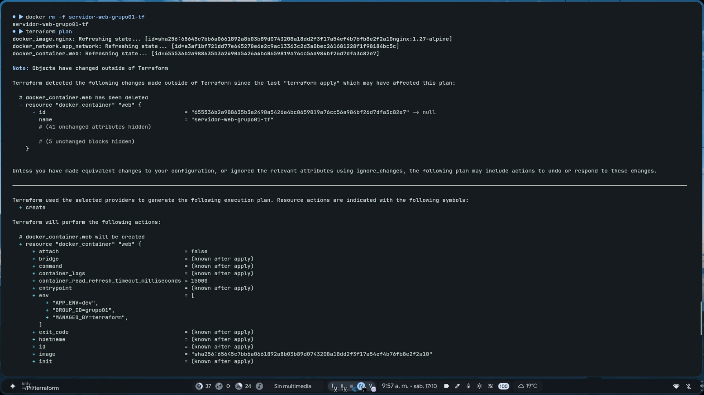
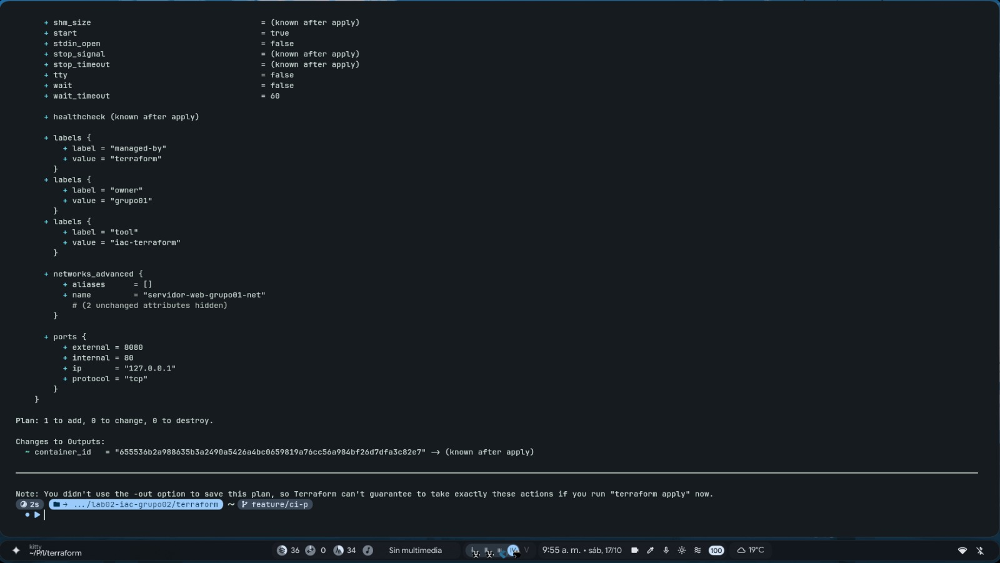
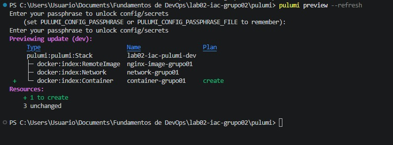
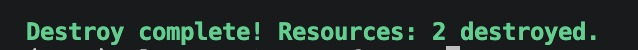
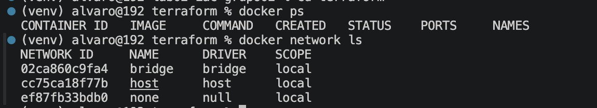
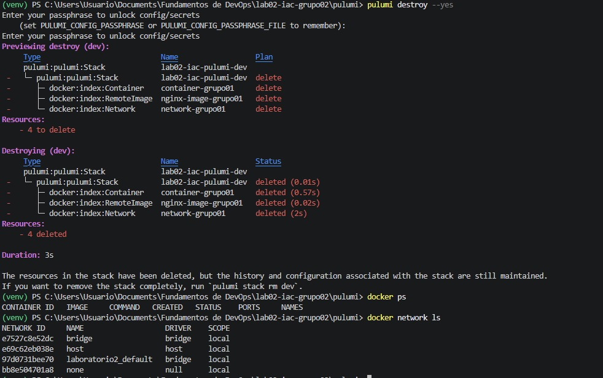

# Informe Comparativo de Infraestructura como Código (IaC) y Flujo de Integración Continua

## Roles y funciones
Grupo: grupo02

Integrantes: 
Alvaro Valderrama - R1 (Terraform) 
Sergio Espinoza - R2 (Pulumi) 
Juan Alonso - R3 (Platform Lead) 

---

## Matriz Comparativa: Terraform vs. Pulumi

La siguiente matriz analiza las diferencias técnicas, operativas y de arquitectura entre las dos soluciones implementadas en el laboratorio:

| Criterio de Comparación | Terraform (HCL) | Pulumi (Python) | Análisis del Grupo con Evidencia Observada |
| :--- | :--- | :--- |:--- |
| **1. Curva de aprendizaje y sintaxis** | DSL declarativo especializado | Lenguaje general orientado a objetos | Terraform puesto que R1 ya tenía experiencia trabajando con la herramienta, mientras que ningún miembro del equipo había trabajado con Pulumi|
| **2. Líneas de código efectivas (LOC)** | 120 líneas | 56 líneas | Pulumi es menos repetitivo puesto que importa librerías como en Python, mientras que en Terraform se tiene que declarar cada recurso |
| **3. Manejo del Estado (State)** | Archivo terraform.tfstate | Metadatos de Stack local en ~/.pulumi | Evidenciamos que en cuanto a poder visualizar el estado, ninguno sobresale frente al otro y depende más de la experiencia de quien está construyendo el proyecto |
| **4. Validación de variables y tipos** | Bloque validation *{condition = ... }* | TLógica en Python *( if... raise ValueError )* | Terraform ofrece una visual más directa frente a la validación de variables y errores, mientras que en Pulumi una experiencia más avanzada enfocada en un público más técnico. |
| **5. Detección y corrección de Drift** | terraform plan | pulumi preview -- refresh | Las dos herramientas detectaron de manera eficiente que el recurso no existe y actualizan la información coherentemente sin tantos pasos extra.|
| **6. Multiplicidad y ciclos** | Meta-argumento count / for_each | Bucle estándar for en listas Python | Como es una actividad sencilla de un ciclo repetitivo, depende más de la experiencia ya que la lógica es relativamente la misma. |
| **7. Ecosistema de Linters / Shift-Left** | terraform fmt, validate | ruff, flake8 | Se demoró más la herramienta de Terraform, el doble de tiempo *(12s vs 6s)*|

## Evidencias drift realizados en las plataformas

### Drift en Terraform

### Drift en Pulumi

### Evidencias del destroy en terraform

### Evidencias del destroy en pulumi

---
## Conclusión Arquitectónica

Responder en 2 párrafos: Si tuvieran que desplegar una arquitectura de microservicios en una
empresa donde todos los desarrolladores son de Python pero no saben DevOps, ¿cuál
herramienta elegirían y qué precauciones tomarían?

La herramienta escogida es Pulumi. Dada la familiaridad del equipo desarrollador con el lenguaje Python, se disminuye considerablemente el tiempo empleado en aprender a implementar y desplegar proyectos. Sin embargo, como no se tiene experiencia en DevOps, es muy importante tener precauciones en seguridad, costos, CI/CD y más apartados importantes en un proyecto con estas características. Como recomendación, al conocer el lenguaje, se puede destinar más tiempo a los apartados mencionados.

El porqué de no escoger Terraform va más encaminado a la dificultad que conlleva aprender una sintaxis nueva y las peculiaridades de la herramienta, elevando exponencialmente la curva de aprendizaje. Esto puede incurrir en costos extra, como capacitar al equipo, y en errores más frecuentes.

---
